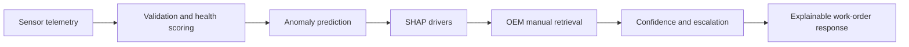

# 🔧 PredMaint AI

<p align="center">
  <strong>Interactive predictive maintenance for industrial equipment</strong><br>
  Sensor analytics · SHAP explanations · OEM manual retrieval · Streamlit dashboards
</p>

<p align="center">
  <a href="https://industrial-predmaint-ai-d3sdstpce4nxkhghcq8zpk.streamlit.app"></a>
  
  
  
</p>

<p align="center">
  <a href="#-run-the-streamlit-app">Run locally</a> ·
  <a href="#-what-you-can-explore">Explore the dashboard</a> ·
  <a href="#-deploy-on-streamlit-community-cloud">Deploy</a> ·
  <a href="#-api-response-contract">API contract</a>
</p>

PredMaint AI combines machine health scoring, anomaly prediction, local SHAP explanations, and a retrieval-grounded maintenance copilot. Its Streamlit interface is designed for exploration: filter assets, adjust telemetry inputs, inspect operating trends, and interact with Plotly charts using hover, zoom, pan, and legend controls.

> **Live app:** [industrial-predmaint-ai.streamlit.app](https://industrial-predmaint-ai-d3sdstpce4nxkhghcq8zpk.streamlit.app)

---

## ✨ What you can explore

| Area | What it does |
|---|---|
| **Copilot console** | Runs telemetry triage, shows SHAP drivers, retrieves related OEM procedures, and presents safety and work-order guidance. |
| **Live fleet monitor** | Follows simulated asset readings, health scores, and predicted risk over time. |
| **Analytics explorer** | Filters synthetic operating data and compares sensor distributions, correlations, trends, and breakdown patterns. |
| **Prediction & explainability** | Lets you enter sensor values, review risk, and inspect feature contributions. |
| **Health, TTF & downtime** | Explores asset health, time-to-failure estimates, and downtime cost scenarios. |
| **Model and operations pages** | Reviews model registry, maintenance schedules, OEE, and drift summaries. |

### Interactive charts

Charts are built with Plotly and rendered with Streamlit's `st.plotly_chart`. Hover for values, drag to zoom, double-click to reset, pan across time series, and click legend entries to show or hide series.

<details>
<summary>Chart gallery</summary>

- SHAP sensor attribution and feature importance
- Copilot execution flow and manual retrieval similarity
- Sensor trends, distributions, boxplots, violin plots, and correlation heatmaps
- Fleet health treemap, health gauges, and live prediction timeline
- Time-to-failure schedule and downtime cost comparisons
- Sensor deviation radar and anomaly trigger summaries

</details>

---

## 🚀 Run the Streamlit app

Use Python 3.11, matching the repository's `runtime.txt`.

```bash
git clone https://github.com/SumedhPatil1507/industrial-predmaint-ai.git
cd industrial-predmaint-ai
python -m venv .venv
```

Activate the environment, then install dependencies and launch the UI from the repository root:

```bash
# Windows PowerShell
.venv\Scripts\Activate.ps1

# macOS / Linux
# source .venv/bin/activate

python -m pip install -r requirements_cloud.txt
python -m streamlit run frontend/app.py
```

The dashboard dependency file keeps the Streamlit install focused on the UI, charts, model, and Copilot features. The app generates sample industrial telemetry and trains a model if compatible saved model files are not present. Use **Generate next live tick** in the sidebar to advance the simulated fleet and update its charts. Plots are interactive: hover for readings, zoom or pan, and click legend entries to toggle series. No API server is needed for the Streamlit dashboard. To run the optional REST and WebSocket backend in a second terminal, install the full requirements first:

```bash
python -m pip install -r requirements.txt
python -m uvicorn backend.main:app --reload --port 8000
```

Then open [http://localhost:8000/docs](http://localhost:8000/docs) for the API explorer.

## ☁️ Deploy on Streamlit Community Cloud

1. Push this repository to GitHub.
2. In Streamlit Community Cloud, create an app from the repository and branch.
3. Set **Main file path** to `frontend/app.py`.
4. Set the dependency file to `requirements_cloud.txt` and use Python 3.11.
5. Add optional secrets in the app's Streamlit settings if the features you use require them.

The repository includes `.streamlit/config.toml` for the dark dashboard theme. Streamlit Cloud uses `requirements_cloud.txt` for UI dependencies and `runtime.txt` (Python 3.11).

The copilot startup path validates its structured work-order payload with Pydantic; it does not require a Guardrails import during Streamlit startup.

## 🧭 How diagnosis works



The maintenance copilot combines the measured reading, model output, SHAP attribution, and retrieved manual context. SOP steps, safety guidance, and listed parts are checked against retrieved sources before a work order is accepted.

### API response contract

The `/predict`, `/advise`, and `/copilot/diagnose` diagnosis endpoints return this JSON shape:

```json
{
  "verdict": "CRITICAL_ANOMALY_DETECTED",
  "reasoning": "Top SHAP sensor drivers: Vibration Z Axis +3.42 SHAP. FFT spectral resonance at 2.4 kHz.",
  "recommendation": "L3 escalation; follow OEM SOP PMP-SOP-001.",
  "next_steps": [
    "Step 1: Apply the cited OEM safety protocol: LOTO-PMP-001",
    "Step 2: Replace drive end bearing Part #BRG-6208-C3",
    "Step 3: Perform alignment and verify the OEM clearance tolerance"
  ]
}
```

Values depend on the telemetry and retrieved manual. The API includes only the four contract fields shown above; it does not claim an SOP, part, tolerance, or spectral peak that was not provided by the relevant source data.

<details>
<summary>REST and WebSocket endpoints</summary>

| Method | Endpoint | Purpose |
|---|---|---|
| `POST` | `/predict` | Validated single-reading prediction and explainable response |
| `POST` | `/advise` | Copilot-assisted advice for a sensor reading |
| `POST` | `/copilot/diagnose` | Copilot diagnosis and explainable response |
| `POST` | `/copilot/search-manuals` | Search equipment manuals and procedures |
| `GET` | `/copilot/manuals` | List available manuals |
| `GET` | `/copilot/work-orders` | Read generated work-order history |
| `WS` | `/ws/scored-stream` | Scored telemetry stream with anomaly-triggered copilot flow |
| `WS` | `/ws/live-sensors` | Raw live sensor stream |
| `POST` | `/health-score` | Calculate a reading's health score |
| `POST` | `/ttf` | Estimate fleet time to failure |
| `POST` | `/shap` | Compute batch feature attribution |
| `POST` | `/ingest/mqtt` | Ingest an MQTT payload |
| `POST` | `/ingest/opcua` | Ingest an OPC-UA frame |

</details>

## 🧪 RAGAS evaluation

An optional evaluation script scores 50 deterministic industrial failure scenarios for Context Precision, Context Recall, Faithfulness, and Answer Relevancy. It requires an OpenAI API key for the RAGAS judge and embeddings.

```bash
# Set OPENAI_API_KEY in your environment first
python eval/ragas_copilot_eval.py --output eval/reports/ragas_copilot_audit.json
```

The generated audit JSON includes per-scenario responses, retrieved context IDs, metric scores, errors, and aggregate means. The report is generated locally and is not required to run the Streamlit app.

## 🗂️ Repository map

```text
backend/
  copilot/       LangGraph flow, manual retrieval, SHAP, and response validation
  main.py        FastAPI REST and WebSocket service
  ml_engine.py   Prediction, feature engineering, and model utilities
frontend/
  app.py         Streamlit dashboard
  charts.py      Interactive Plotly figures
  data_engine.py Synthetic history and live telemetry
eval/
  ragas_copilot_eval.py  50-scenario RAGAS audit
requirements.txt         App and API dependencies
runtime.txt              Python runtime selection
```

## 🔐 Configuration

Copy `.env.example` to `.env` for local development. Secrets are optional for the standalone demo; configure only the integrations you intend to use.

| Variable | Used for |
|---|---|
| `OPENAI_API_KEY` | Optional LLM features and running the RAGAS evaluation |
| `SUPABASE_URL`, `SUPABASE_KEY` | Optional hosted persistence |
| `OPCUA_ENDPOINT_URL`, `OPCUA_EMERGENCY_STOP_NODE`, `OPCUA_SPEED_LIMIT_NODE` | OPC-UA endpoint and PLC tags for the safety-gated write-back client |
| `OPCUA_USER`, `OPCUA_PASSWORD`, `OPCUA_SECURITY_STRING` | Optional OPC-UA authentication and message security |
| `SMTP_HOST`, `SLACK_BOT_TOKEN` | Optional notifications |

Never commit `.env` or Streamlit secrets to GitHub.

Automatic PLC writes from `/ingest/opcua` are authorized only by validated
telemetry thresholds in `backend/opcua_client.py`. Invalid or non-Good OPC-UA
readings fail closed; model and LLM recommendations cannot authorize an
emergency stop or speed throttle. Confirm the configured limits and PLC node
IDs against the specific machine before enabling write access.

## 🛠️ Stack

**Streamlit · Plotly · FastAPI · scikit-learn · SHAP · LangGraph · Pydantic · pandas · NumPy**

## 🤝 Contributing

See [CONTRIBUTING.md](CONTRIBUTING.md) for development guidance. Issues and pull requests are welcome.

## 📄 License

MIT. See [LICENSE](LICENSE).
